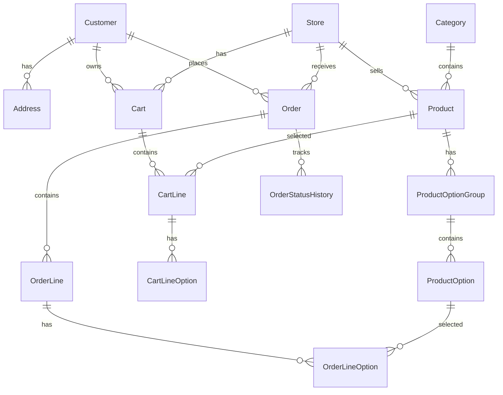

# Day 1 — Database and API

## 1. Database Tables Diagram

The database contains the following main entities and relationships:



## 2. Important Technical Decisions

### Restrict Relationships

I used `DeleteBehavior.Restrict` for relationships to prevent deleting a record that is still referenced by other records.

This protects related data and prevents accidental cascading deletes.

### DataAnnotations

I chose DataAnnotations for request validation because they are built into .NET and are sufficient for the validation requirements of this project.

They allow validation rules to be defined directly on DTO properties without adding another validation library.

### Bulk Library

I used `EFCore.BulkExtensions` to insert large amounts of seed data efficiently.

Instead of inserting every record individually, the library inserts records in batches, reducing database operation overhead.

### Order Code Counter

The order code is generated using three parts to produce a unique 12-digit code.

The counter ensures that newly created orders receive sequentially increasing codes.

### Atomic Place Order

The order creation process uses a database transaction.

The order, its order lines, and related changes are saved together. If an operation fails, the transaction is rolled back so that partial order data is not saved.

## 3. Seed Data Results

The following table records the number of rows inserted and the time taken for each table during reseeding.

| Table | Rows Inserted | Time |
|---|---:|---:|
| Customers | To be measured | To be measured |
| Addresses | To be measured | To be measured |
| Stores | To be measured | To be measured |
| Categories | To be measured | To be measured |
| Products | To be measured | To be measured |
| ProductOptionGroups | To be measured | To be measured |
| ProductOptions | To be measured | To be measured |
| Carts | To be measured | To be measured |
| CartLines | To be measured | To be measured |
| CartLineOptions | To be measured | To be measured |
| Orders | To be measured | To be measured |
| OrderLines | To be measured | To be measured |
| OrderLineOptions | To be measured | To be measured |
| OrderStatusHistories | To be measured | To be measured |

## 4. Product Search SQL

Paste the SQL query generated by Entity Framework Core when running the product search endpoint in Development mode:

```sql
-- Paste the generated SQL query here.
```

The filters, sorting, and pagination are executed by SQL Server because the query is built using `IQueryable` before it is executed.

I verified this by checking the SQL statements printed in the application console logs.

## 5. Store Dashboard Performance

Endpoint:

`GET /api/v1/stores/3/dashboard`

| Attempt | Response Time |
|---|---:|
| 1 | To be measured |
| 2 | To be measured |
| 3 | To be measured |

The target response time is less than one second with the full seed data.

Final measured result: **To be measured.**

## 6. Hardest Problem

The hardest problem during this work was:

**[Write the problem you found most difficult.]**

I investigated the problem by checking the relevant code, understanding the cause, and testing the solution to verify that it worked correctly.

## 7. What I Would Do Differently Next Time

I would divide the work into smaller steps, test each feature immediately after implementing it, and document important decisions and results while working.

This would make debugging easier and reduce the need to revisit completed work.