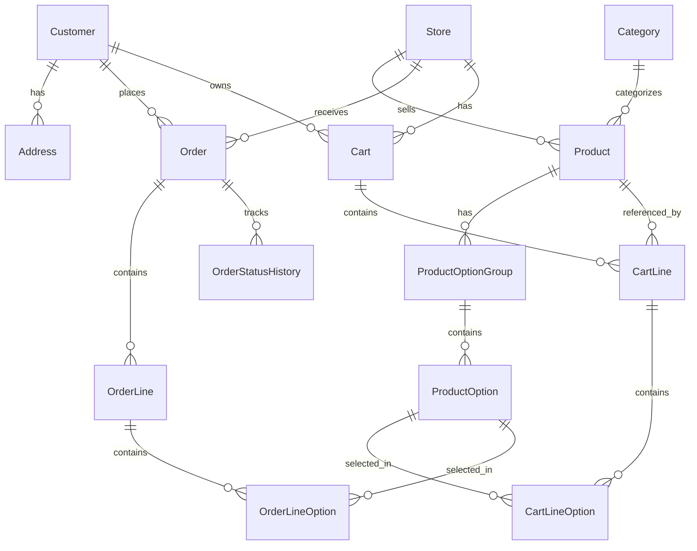

# Day 1 — Database and API

## 1. Database Tables Diagram

The database contains the following main entities and relationships:



## 2. Technical Decisions

### DeleteBehavior.Restrict

I used `DeleteBehavior.Restrict` for relationships to prevent deleting records that are still referenced by other records.

This protects important business data and prevents accidental cascading deletion.

### Data Annotations

I used Data Annotations to define validation and database constraints, such as:

- `[Required]` for mandatory fields.
- `[MaxLength]` for maximum string lengths.
- `[Precision]` for decimal values.
- `[EmailAddress]` for email validation.

These attributes help keep validation rules close to entity properties and make the database schema more consistent.

### Order Code Generation

Order codes are generated using a SQL Server sequence named `OrderCodeSequence`.

The application retrieves the next sequence value using:

```sql
NEXT VALUE FOR dbo.OrderCodeSequence
```

This provides a database-generated counter for order code generation.

### Atomic Order Creation

Order creation uses a database transaction to ensure that related operations succeed or fail together.

This prevents partially created orders if one of the operations fails.

## 3. Seed Data Results

The following counts are reference results from the Day 2 seed run. They are included for reference and are not claimed as separate Day 1 measurements.

| Entity | Reference Count |
|---|---:|
| Stores | 50 |
| Categories | 30 |
| Customers | 20,000 |
| Addresses | 35,000 |
| Products | 40,000 |
| Orders | 300,000 |
| OrderLines | 970,341 |
| OrderStatusHistory | 1,389,143 |

**Note:** The `Users` table was introduced on Day 2 and is therefore not included in the Day 1 entity list.

## 4. Product Search Query

Product search uses `IQueryable` so filtering, sorting, and pagination can be translated into SQL and executed by SQL Server instead of loading all records into application memory.

The endpoint was tested using:

```http
GET /api/v1/products?page=1&pageSize=10&storeId=225
```

### SQL Generated by EF Core

EF Core generated two SQL queries.

**1. Count matching products:**

```sql
SELECT COUNT(*)
FROM [Product] AS [p]
WHERE [p].[IsDeleted] = CAST(0 AS bit)
  AND [p].[StoreId] = @searchDto_StoreId_Value;
```

**2. Fetch paginated products:**

```sql
SELECT [p].[Id],
       [p].[Name],
       [p].[Price],
       [p].[StockQuantity],
       [p].[StoreId],
       [p].[CategoryId]
FROM [Product] AS [p]
WHERE [p].[IsDeleted] = CAST(0 AS bit)
  AND [p].[StoreId] = @searchDto_StoreId_Value
ORDER BY [p].[Name], [p].[Id]
OFFSET @p ROWS FETCH NEXT @p2 ROWS ONLY;
```

### Test Results

| Measurement | Result |
|---|---:|
| Total matching products | 800 |
| Page | 1 |
| Page size | 10 |
| Count query execution | 59 ms |
| Products query execution | 13 ms |
| HTTP response time | 200.65 ms |
| HTTP status | 200 OK |

### Explanation

- `Where()` is translated into SQL `WHERE`.
- `OrderBy()` is translated into SQL `ORDER BY`.
- `Skip()` and `Take()` are translated into `OFFSET` and `FETCH NEXT`.
- `CountAsync()` executes a separate `COUNT(*)` query.
- Pagination is executed by SQL Server rather than loading all matching products into memory first.

## 5. Store Dashboard Performance

**Endpoint:**

```http
GET /api/v1/stores/225/dashboard
```

The endpoint was tested three times using Postman.

| Attempt | Response Time |
|---|---:|
| 1 | 1420 ms |
| 2 | 472 ms |
| 3 | 831 ms |
| **Average** | **907.7 ms** |

**Target:** Less than 1 second.

**Result:** Passed. The average response time was approximately 908 ms, which is below the 1-second target.

The dashboard response included:

- Today's order count and revenue.
- Top five products.
- Average order value.
- Active order status counts.

## 6. Hardest Problem

The hardest problem during Day 1 was creating service interfaces and connecting them to their implementations using Dependency Injection.

### Why It Was Difficult

Understanding how interfaces, implementations, and dependency registration work together across the project layers was challenging.

### How It Was Solved

- Created service interfaces.
- Implemented the interfaces in the Service layer.
- Registered the service implementations in `Program.cs` using Dependency Injection.
- Used constructor injection to provide the required dependencies.

### What I Learned

Dependency Injection allows the application to depend on abstractions rather than concrete implementations, making the code more organized and easier to maintain.

## 7. What I Would Do Differently

- Break implementation into smaller steps.
- Test each feature immediately after implementing it.
- Check generated SQL when working with EF Core queries.
- Record actual test results instead of leaving measurements until later.
- Document important technical decisions while implementing them.